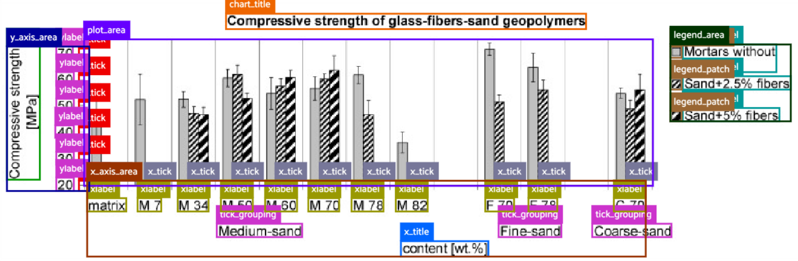
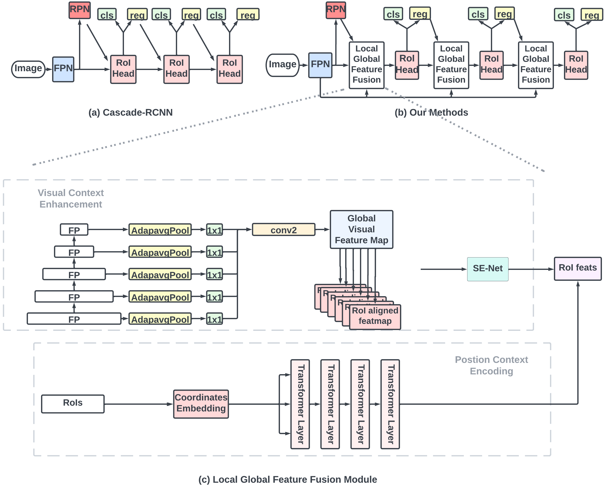
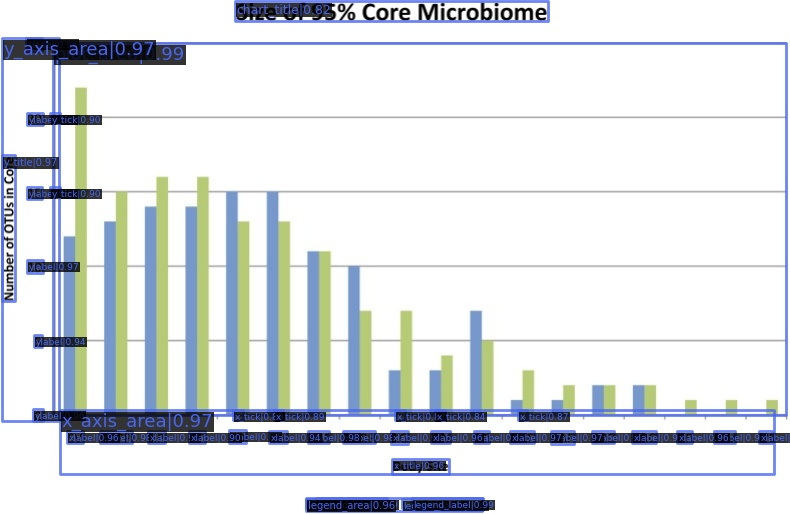

<div align="center">

# CACHED: Context-Aware Chart Element Detection

**Pengyu Yan\*, Saleem Ahmed\*, David Doermann** (\*equal contribution)

University at Buffalo

**ICDAR 2023**: International Conference on Document Analysis and Recognition

[](https://link.springer.com/chapter/10.1007/978-3-031-41676-7_13)
[](https://arxiv.org/abs/2305.04151)
[](https://huggingface.co/Pengyu965/ChartDete)
[](https://huggingface.co/datasets/Pengyu965/ChartDete-PMC2022)
[](LICENSE)

</div>

This is the official repository for the ICDAR 2023 paper **Context-Aware Chart Element Detection** (CACHED). CACHED
detects the basic elements of chart images, such as axis titles, tick labels, tick marks, and legend entries, by
adding visual and positional context to a Cascade R-CNN detector. The code is built on
[MMDetection](https://github.com/open-mmlab/mmdetection) 2.x.

## 📰 News

- **[Oct 2026]** For easier access, the **model checkpoints** and the **refined PMC dataset** are now also hosted on
  Hugging Face: [🤗 Model](https://huggingface.co/Pengyu965/ChartDete) ·
  [🤗 Dataset](https://huggingface.co/datasets/Pengyu965/ChartDete-PMC2022). These are the original 2023 releases,
  unchanged. They are not a new version or new work.
- **[Aug 2023]** CACHED was published at **ICDAR 2023**
  ([Springer](https://link.springer.com/chapter/10.1007/978-3-031-41676-7_13)).
- **[May 2023]** Preprint released on [arXiv](https://arxiv.org/abs/2305.04151).
- **[Apr 2023]** Code, checkpoints, and the refined PMC dataset released.

## ✨ Overview

Detecting the basic elements of a chart is the first step of chart data extraction, and every later step depends on
it. Unlike objects in natural images, many chart elements look alike and differ only in their **role**. A text block
can be a tick label, a legend label, or a value label depending on where it sits and what surrounds it. Chart element
detection therefore depends heavily on **context**.



**Contributions**

- 🧠 **A local-global context fusion module** for chart element detection. It adds visual context (VCE) and
  positional context (PCE) to every region of interest, and gives state-of-the-art results on chart element
  detection.
- 🏷️ **Refined chart element categories.** Axis-related elements are split into x and y, and structural areas
  (plot, x-axis, y-axis, and legend area) are added, for **18 classes** in total. The PMC dataset of the ICPR 2022
  CHART-Infographics competition was updated to these categories and converted to COCO format.
- 📊 **A benchmark of common detectors** (DETR, Faster R-CNN, Cascade R-CNN) trained and evaluated on the refined
  dataset. Their checkpoints are released together with CACHED.

### Framework



CACHED inserts a **local-global context fusion module** before each of the three RoI heads of a Cascade R-CNN with a
Swin-T FPN backbone:

- **Visual context enhancement (VCE)** pools the whole feature pyramid into a global feature map and fuses it with
  each RoI feature (with an SE block), so every region sees the full chart.
- **Positional context encoding (PCE)** runs a Transformer over the normalized box coordinates of all proposals, so
  the model learns the layout patterns of charts.
- **Focal loss and balanced L1 loss** handle the strong class imbalance of chart elements.

## 📦 Model and dataset

| Resource | 🤗 Hugging Face (recommended) | Original download |
|---|---|---|
| **Checkpoints** (CACHED, bar detector, and baselines) | [`Pengyu965/ChartDete`](https://huggingface.co/Pengyu965/ChartDete) | [Google Drive](https://drive.google.com/file/d/1htEEzRVE9Qlppz8ZgyEPJ3OI1HHY6gDS/view?usp=sharing) |
| **Refined PMC dataset** (COCO format) | [`Pengyu965/ChartDete-PMC2022`](https://huggingface.co/datasets/Pengyu965/ChartDete-PMC2022) | [Google Drive](https://drive.google.com/file/d/1YZmRy9TcaOJ6tA8DLeG0sXhSjwqqAw_h/view?usp=sharing) |

**Checkpoints.** Each folder has a config and its checkpoint. Test AP is the COCO box AP reported in the paper, on
the test split of the refined PMC dataset. The [model card](https://huggingface.co/Pengyu965/ChartDete) also lists the
AP re-measured with the hosted files.

| Folder (under `work_dirs/`) | Model | Test AP |
|---|---|---:|
| `cascade_rcnn_swin-t_fpn_LGF_VCE_PCE_coco_focalsmoothloss/` | **CACHED** (`checkpoint.pth`, 18 classes) | **0.729** |
| `cascade_rcnn_swin-t_fpn_LGF_VCE_PCE_coco_focalsmoothloss/` | **CACHED bar detector** (`bar_checkpoint.pth`, 1 class) | – |
| `cascade_rcnn_swin-t-p4-w7_fpn_1x_coco/` | Cascade R-CNN, Swin-T FPN | 0.699 |
| `cascade_rcnn_x101_64x4d_fpn_20e_coco/` | Cascade R-CNN, ResNeXt-101 FPN | 0.696 |
| `faster_rcnn_x101_64x4d_fpn_2x_coco/` | Faster R-CNN, ResNeXt-101 FPN | 0.665 |
| `detr_finetune/` | DETR | 0.536 |

**Dataset.** The refined PMC dataset has 5,052 / 560 / 381 chart images for train / val / test element detection,
plus a bar-chart subset for bar detection. The [dataset card](https://huggingface.co/datasets/Pengyu965/ChartDete-PMC2022)
lists the 18 categories with their definitions and counts. The code expects this layout:

```
data/
└── pmc_2022/
    ├── pmc_coco/                     # refined categories, COCO format
    │   ├── element_detection/
    │   │   ├── train/  val/  split3_test/          # images
    │   │   └── train.json  val.json  split3_test.json
    │   └── plots_detection/
    │       ├── bar_images/  bar_test/              # images
    │       └── bar_train.json  bar_val.json  bar_test.json  baronly_test.json
    ├── train_original/               # original ICPR 2022 PMC training release
    └── test_original/                # original ICPR 2022 PMC test release (splits 1-5)
```

The category refinement and COCO conversion code is in [`pmc2coco_converter/`](pmc2coco_converter).

## 🔧 Installation

The code was built and tested with PyTorch 1.13.1 and CUDA 11.7. It needs `mmcv-full` 1.x and does not work with
`mmcv` 2.x.

```bash
conda create -n ChartDete python=3.8 -y
conda activate ChartDete

pip install torch==1.13.1+cu117 torchvision==0.14.1+cu117 --extra-index-url https://download.pytorch.org/whl/cu117
pip install mmcv-full==1.7.2 -f https://download.openmmlab.com/mmcv/dist/cu117/torch1.13/index.html

git clone https://github.com/pengyu965/ChartDete
cd ChartDete
pip install -v -e .
pip install huggingface_hub   # for downloading checkpoints and data from Hugging Face
```

See the [MMDetection documentation](https://mmdetection.readthedocs.io/en/v2.28.1/get_started.html) for other setups.

## 📥 Download checkpoints and data

Run these from the repo root. They place the files where the configs expect them.

```bash
# CACHED checkpoints (element + bar detector, about 3.1 GB)
hf download Pengyu965/ChartDete --include "cascade_rcnn_swin-t_fpn_LGF_VCE_PCE_coco_focalsmoothloss/*" --local-dir work_dirs
# or all checkpoints, including the baselines (about 6.3 GB)
hf download Pengyu965/ChartDete --include "*/*.py" "*/*.pth" --local-dir work_dirs

# Refined PMC dataset, COCO part only (304 MB)
hf download Pengyu965/ChartDete-PMC2022 pmc_coco.zip --repo-type dataset --local-dir data/pmc_2022
unzip -oq data/pmc_2022/pmc_coco.zip -d data/pmc_2022/
# or the full archive, including the original ICPR 2022 release (2.1 GB)
hf download Pengyu965/ChartDete-PMC2022 pmc_2022.zip --repo-type dataset --local-dir data
unzip -oq data/pmc_2022.zip -d data/
```

The Google Drive archives in the table above have the same content. Unzip them into `work_dirs/` and `data/`.

## 🚀 Quick start

```python
from mmdet.apis import init_detector, inference_detector

name = "cascade_rcnn_swin-t_fpn_LGF_VCE_PCE_coco_focalsmoothloss"
config = f"work_dirs/{name}/{name}.py"
checkpoint = f"work_dirs/{name}/checkpoint.pth"
model = init_detector(config, checkpoint, device="cuda:0")  # or device="cpu"

result = inference_detector(model, "sample.jpg")  # one (N, 5) array per class: [x1, y1, x2, y2, score]

for class_name, dets in zip(model.CLASSES, result):
    for x1, y1, x2, y2, score in dets[dets[:, 4] > 0.3]:
        print(f"{class_name:14s} {score:.2f}  [{x1:.0f}, {y1:.0f}, {x2:.0f}, {y2:.0f}]")

model.show_result("sample.jpg", result, score_thr=0.3, out_file="sample_result.jpg")
```



To skip the manual download, pass files fetched with `huggingface_hub.hf_hub_download` instead of local paths. The
[model card](https://huggingface.co/Pengyu965/ChartDete) shows how, and also covers the bar detector
(`{name}_bar.py` with `bar_checkpoint.pth`).

## 🏋️ Training and evaluation

Training and testing follow the standard MMDetection 2.x routine. See the
[MMDetection tutorial](docs/en/1_exist_data_model.md) for more options.

**Evaluate** a checkpoint on the test split (COCO box AP):

```bash
CONFIG=work_dirs/cascade_rcnn_swin-t_fpn_LGF_VCE_PCE_coco_focalsmoothloss/cascade_rcnn_swin-t_fpn_LGF_VCE_PCE_coco_focalsmoothloss.py
CHECKPOINT=work_dirs/cascade_rcnn_swin-t_fpn_LGF_VCE_PCE_coco_focalsmoothloss/checkpoint.pth

python tools/test.py $CONFIG $CHECKPOINT --eval bbox            # single GPU
bash tools/dist_test.sh $CONFIG $CHECKPOINT 4 --eval bbox       # 4 GPUs
```

**Train** CACHED or a baseline with a config from [`configs/`](configs). The released models were trained on 4 GPUs
with 3 images per GPU. Use a new `--work-dir` so that the run does not write into the folders of the downloaded
checkpoints:

```bash
bash tools/dist_train.sh configs/cascade_rcnn_swin-t_fpn_LGF_VCE_PCE_coco_focalsmoothloss.py 4 --work-dir work_dirs/cached_train
```

**Fine-tune the bar detector.** Its config, `cascade_rcnn_swin-t_fpn_LGF_VCE_PCE_coco_focalsmoothloss_bar.py`, comes
with the checkpoints. It trains on `baronly_train.json` and `baronly_val.json`, which can be created from
`bar_train.json` and `bar_val.json` with the short script on the
[dataset card](https://huggingface.co/datasets/Pengyu965/ChartDete-PMC2022#bar-only-annotations-for-the-bar-detector).
The released bar detector was fine-tuned from the CACHED checkpoint:

```bash
NAME=cascade_rcnn_swin-t_fpn_LGF_VCE_PCE_coco_focalsmoothloss
bash tools/dist_train.sh work_dirs/$NAME/${NAME}_bar.py 4 --work-dir work_dirs/bar_finetune \
    --cfg-options load_from=work_dirs/$NAME/checkpoint.pth
```

The CACHED modules are implemented in
[`mmdet/models/roi_heads/cascade_roi_head_LGF.py`](mmdet/models/roi_heads/cascade_roi_head_LGF.py) (cascade head with
the local-global context fusion module),
[`mmdet/models/roi_heads/bbox_encoding_transformer.py`](mmdet/models/roi_heads/bbox_encoding_transformer.py)
(positional context encoder), and
[`mmdet/models/roi_heads/bbox_heads/convfc_bbox_head.py`](mmdet/models/roi_heads/bbox_heads/convfc_bbox_head.py)
(`Shared3FCBBoxHead_with_BboxEncoding`).

## 📊 Results

**COCO evaluation on the refined PMC dataset** (test split). The first four rows are standard detectors. The last
three rows are the CACHED ablation; <sup>L</sup> marks the focal loss and balanced L1 loss.

| Model | Context module | Backbone | AP | AP50 | AP75 | APS | APM | APL |
|---|---|---|---:|---:|---:|---:|---:|---:|
| DETR | – | – | 0.536 | 0.762 | 0.572 | 0.384 | 0.555 | 0.809 |
| Faster R-CNN | – | ResNeXt101-FPN | 0.665 | 0.815 | 0.737 | 0.557 | 0.697 | 0.827 |
| Cascade R-CNN | – | ResNeXt101-FPN | 0.696 | 0.825 | 0.759 | 0.579 | 0.725 | 0.899 |
| Cascade R-CNN | – | SwinT-FPN | 0.699 | 0.838 | 0.772 | 0.589 | 0.732 | 0.885 |
| Cascade R-CNN | PCE | SwinT-FPN | 0.708 | 0.842 | 0.775 | 0.591 | 0.742 | 0.903 |
| Cascade R-CNN | VCE + PCE | SwinT-FPN | 0.713 | **0.851** | 0.786 | 0.597 | 0.741 | 0.909 |
| **CACHED** (Cascade R-CNN<sup>L</sup>) | VCE + PCE | SwinT-FPN | **0.729** | 0.845 | **0.790** | **0.602** | **0.763** | **0.939** |

**ICPR 2022 CHART-Infographics competition.** This uses the original PMC categories, so the CACHED predictions are
mapped back to the competition format.

| Method | Task 2: text detection (avg. IoU) | Task 3: text role classification (F-measure) |
|---|---:|---:|
| six_seven_four | 0.435 | – |
| IIIT_CVIT_Chart_Understanding | 0.790 | **0.821** |
| Ystar | 0.810 | – |
| UB-ChartAnalysis | 0.820 | 0.736 |
| **CACHED** | **0.869** | 0.787 |

**Bar detection on the PMC test set** (F-measure at different IoU thresholds, and the chart competition score). The
other results are from [Ma et al. (2021)](https://arxiv.org/abs/2105.02039).

| Model | IoU=0.5 | IoU=0.7 | IoU=0.9 | Score_a |
|---|---:|---:|---:|---:|
| SSD | 43.65 | 26.28 | 2.67 | 25.83 |
| YOLO-v3 | 58.84 | 36.14 | 4.14 | 60.97 |
| Faster R-CNN | 66.37 | 60.88 | 29.13 | 70.03 |
| Faster R-CNN + FPN | 85.81 | 78.05 | 31.30 | 89.65 |
| Cascade R-CNN + FPN | 86.92 | 83.53 | 55.32 | 91.76 |
| **CACHED** | **89.30** | **88.73** | **76.94** | **93.75** |

## 📝 Citation

If you find this work useful, please cite:

```bibtex
@inproceedings{yan2023cached,
  title     = {Context-Aware Chart Element Detection},
  author    = {Yan, Pengyu and Ahmed, Saleem and Doermann, David},
  booktitle = {Document Analysis and Recognition - ICDAR 2023},
  pages     = {218--233},
  year      = {2023},
  publisher = {Springer Nature Switzerland},
  doi       = {10.1007/978-3-031-41676-7_13}
}
```

## 🙏 Acknowledgements

This code is built on [MMDetection](https://github.com/open-mmlab/mmdetection) (its original README is kept in
[`MMDET_README.md`](MMDET_README.md)). The PMC chart data comes from the
[ICPR 2022 CHART-Infographics competition](https://chartinfo.github.io/index_2022.html) and is licensed under
[CC BY-NC-SA 4.0](https://creativecommons.org/licenses/by-nc-sa/4.0/).

## License

This project is released under the [MIT License](LICENSE).
